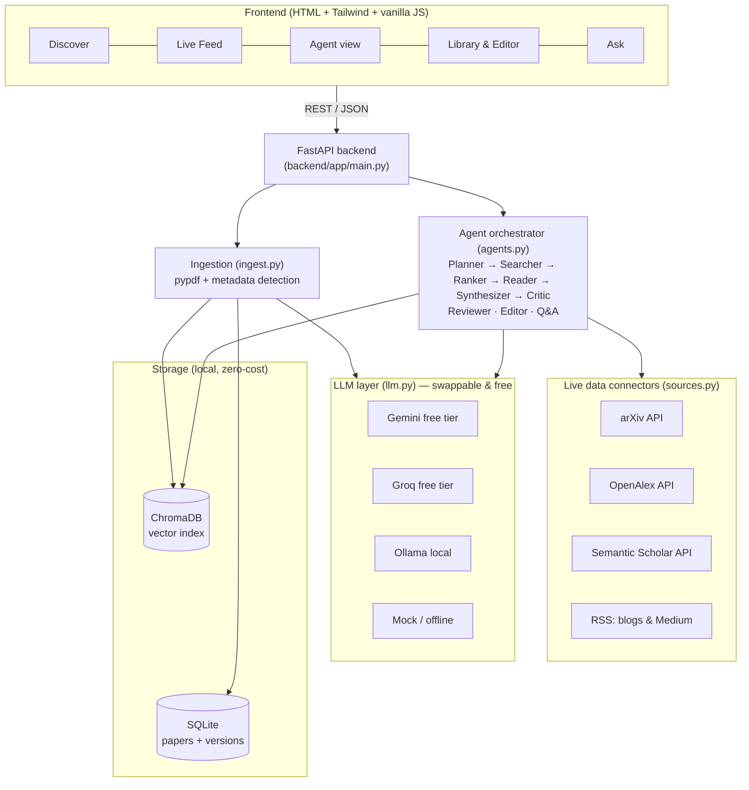

# 🧠 ResearchMind — Autonomous AI Research Assistant Agent

An agentic AI web app that **discovers, reads, reviews, edits and answers questions about research** —
peer-reviewed journals, conference papers, preprints, blogs and Medium articles — with real-time updates.
Runs entirely on **free tiers** (Gemini / Groq / local Ollama) with zero paid infrastructure.

| Feature | What it does |
|---|---|
| 🔎 **Discover** | One search across arXiv, OpenAlex (journals + conferences), Semantic Scholar, blogs & Medium. Dropdown filters: source, published-in type, journal/conference/medium, year range, sort. |
| ⚡ **Live Feed** | Newest AI/ML papers and blog posts, auto-refreshing every 60 s. |
| 🤖 **Research Agent** | Give a goal → Planner → Searcher → Ranker → Reader → Synthesizer → **Critic** produces a cited literature brief with a visible reasoning trace. |
| 📚 **Library + Editor** | Drag & drop PDFs, auto-detected metadata, edit everything, **AI edit** (select text → instruction → apply), version history with restore, export to Markdown. |
| 🧪 **AI Peer Review** | Reviewer agent returns strengths, weaknesses, novelty/rigor/clarity scores, recommendation, suggestions. |
| 💬 **Ask Your Papers** | RAG (ChromaDB) Q&A with numbered citations over your library. |

---

## 1. Architecture



**Request flow (Research Agent):** goal → Planner expands into 3 queries → Searcher hits all sources in parallel →
dedupe + rank → Reader extracts contributions/limitations → Synthesizer writes a cited brief → Critic fact-checks it
against the sources and appends verification notes → UI shows the brief, references and the step-by-step trace.

**Folder structure**
```
researchmind/
├── backend/app/
│   ├── main.py      # FastAPI routes
│   ├── agents.py    # multi-agent pipeline, reviewer, editor, RAG Q&A
│   ├── sources.py   # arXiv / OpenAlex / Semantic Scholar / RSS connectors + cache
│   ├── llm.py       # Gemini / Groq / Ollama / mock behind one interface
│   ├── rag.py       # ChromaDB indexing + retrieval (keyword fallback)
│   ├── ingest.py    # PDF text + metadata extraction
│   ├── db.py        # SQLite library + version history
│   └── config.py
├── frontend/        # index.html + static/app.js + static/styles.css
├── tests/           # offline pytest suite (mock LLM)
├── Dockerfile · requirements.txt · .env.example · .github/workflows/ci.yml
```

---

## 2. Setup — step by step (Windows / macOS / Linux, VS Code)

**Prerequisites:** Python 3.10+ ([python.org](https://www.python.org/downloads/)), VS Code, Git.

1. **Open the project in VS Code:** `File → Open Folder…` → select `researchmind`. Install the **Python** extension (Microsoft).
2. **Create a virtual environment** (VS Code terminal: `` Ctrl+` ``):
   ```bash
   python -m venv .venv
   # Windows PowerShell:   .venv\Scripts\Activate.ps1
   # macOS / Linux:        source .venv/bin/activate
   ```
   Then `Ctrl+Shift+P` → **Python: Select Interpreter** → pick `.venv`.
3. **Install dependencies:**
   ```bash
   pip install -r requirements.txt
   ```
4. **Get a free LLM key (pick one):**
   - **Gemini (recommended):** <https://aistudio.google.com/apikey> → *Create API key*.
   - **Groq:** <https://console.groq.com> → *API Keys*.
   - **Ollama (fully local):** install from <https://ollama.com>, then `ollama pull llama3.2` and set `LLM_PROVIDER=ollama`.
   - No key? It still starts in **mock mode** so you can explore the UI.
5. **Configure:** copy `.env.example` to `.env` and paste your key (`GEMINI_API_KEY=...`). Free-tier model names change over time — if you get a model-not-found error, update `GEMINI_MODEL` / `GROQ_MODEL` from the provider's docs.
6. **Run the tests (optional but great for your repo):**
   ```bash
   pytest -q
   ```
7. **Start the app:**
   ```bash
   uvicorn backend.app.main:app --reload
   ```
8. **Open** <http://127.0.0.1:8000> (API docs at `/docs`).

### Guided tour (also your demo script / GIF)
1. **Discover** → search *"retrieval augmented generation"*, set *Published in = Conference*, *Year from = 2023*.
2. **Live Feed** → watch new arXiv + blog items; filter by type.
3. **Research Agent** → goal: *"What are the latest approaches to reduce LLM hallucinations?"* → inspect trace & brief → *Save to library*.
4. **Library** → drag a PDF onto the drop zone → open it → edit metadata → **Run peer review** → **AI edit** (select a paragraph, "improve clarity") → *Apply* → *Save* → check **Versions**.
5. **Ask Your Papers** → ask a question about the uploaded PDF and see cited passages.

### Docker (optional)
```bash
docker build -t researchmind . && docker run -p 8000:8000 --env-file .env -v rm_data:/app/data researchmind
```

---

## 3. Project case study (the 5 questions)

### 1) What real-world problem is this?
Researchers, students and ML engineers face **information overload**: thousands of AI papers per week across arXiv,
journals, conferences, blogs and Medium, scattered tools (search, PDF reader, notes, reviewer feedback), and a
real risk of citing weak or misread work. Manually triaging, reading, critiquing and writing takes hours, and
generic chatbots hallucinate citations.

### 2) Our solution
A **single agentic workspace** that goes from *"what's out there?"* to *"what should I write/do next?"*:
- Unified, filterable discovery + real-time feed across paper and non-paper media.
- A **multi-agent pipeline with a self-verification (Critic) step** and an inspectable trace → grounded, cited output.
- A **library with RAG** so answers come from *your* documents with citations.
- An **editor with AI assistance, peer-review simulation and version history** so improving a draft is built in.
- A **provider-agnostic LLM layer** so it works on free tiers or fully offline.

### 3) Who are the end users?
Grad students & PhD candidates (literature reviews), industry ML/AI engineers (staying current, due diligence),
academic labs and R&D teams (shared reading lists), technical writers/bloggers/journalists (fast, sourced summaries),
and early-stage founders/analysts evaluating a technology.

### 4) How scalable is it?
- **Today (single node):** SQLite + local ChromaDB comfortably handle thousands of papers for an individual or small team.
- **Stateless API:** FastAPI is stateless apart from storage → scale horizontally behind a load balancer.
- **Upgrade path:** SQLite → PostgreSQL (+ pgvector) · local Chroma → managed vector DB · in-process cache → Redis ·
  synchronous agent runs → Celery/RQ background jobs with streaming (SSE/WebSocket) · add auth + per-user libraries.
- **Source layer is pluggable:** adding PubMed, Crossref, Reddit or GitHub = one function in `sources.py`.

### 5) Is it cost-effective? Future scope?
**Cost:** $0 to run locally — free LLM tiers (Gemini/Groq) or Ollama, free public APIs (arXiv, OpenAlex, Semantic Scholar, RSS),
local storage. The agent batches abstracts into few LLM calls (≈4 per run), caching (5 min TTL) avoids repeat API hits,
and context clipping controls token use. Paid hosting is optional (a small VM or free-tier PaaS suffices).

**Future scope:** user accounts & teams · scheduled digests by email/Slack for saved topics · citation-graph exploration ·
full-text retrieval of open-access PDFs · reference export (BibTeX/Zotero) · LangGraph / tool-calling agent upgrade ·
evaluation harness (citation accuracy, faithfulness) · multilingual support · fine-tuned reviewer models.

---

## 4. Add it to your GitHub profile & resume

```bash
git init
git add .
git commit -m "Initial commit: ResearchMind agentic research assistant"
git branch -M main
git remote add origin https://github.com/<your-username>/researchmind.git
git push -u origin main
```
Create the empty repo on github.com first (no README). Then: add **topics** (`ai-agents`, `llm`, `rag`, `fastapi`, `chromadb`, `research-assistant`),
pin the repo, and record a 60-second screen capture of the guided tour for the README top.

**Resume bullets (edit to match what you did):**
- Built **ResearchMind**, an agentic research assistant (Python, FastAPI, ChromaDB, Gemini/Groq/Ollama) with a Planner→Searcher→Reader→Synthesizer→Critic pipeline that produces cited literature briefs with a self-verification step.
- Integrated four live data sources (arXiv, OpenAlex, Semantic Scholar, RSS) with parallel fetching, de-duplication, ranking and TTL caching for a real-time paper/blog feed with year, venue-type and journal/conference filters.
- Implemented PDF ingestion, RAG Q&A with citations, AI peer-review scoring, AI-assisted editing and version history; designed a provider-agnostic LLM layer enabling $0 operation on free tiers.
- Shipped with an offline pytest suite, GitHub Actions CI and Docker packaging.

## 5. Known limitations (be upfront in interviews)
- Free-tier LLMs are rate-limited; the app retries on HTTP 429 but long agent runs may be slow.
- Reviews/critiques are AI-generated aids, not substitutes for human peer review.
- Scanned (image-only) PDFs need OCR before upload.
- Agent runs are synchronous (no streaming yet); no authentication (single-user by design).
- Public API/feed URLs and free model names can change; update `.env`/`sources.py` if one stops responding.

## License
MIT
